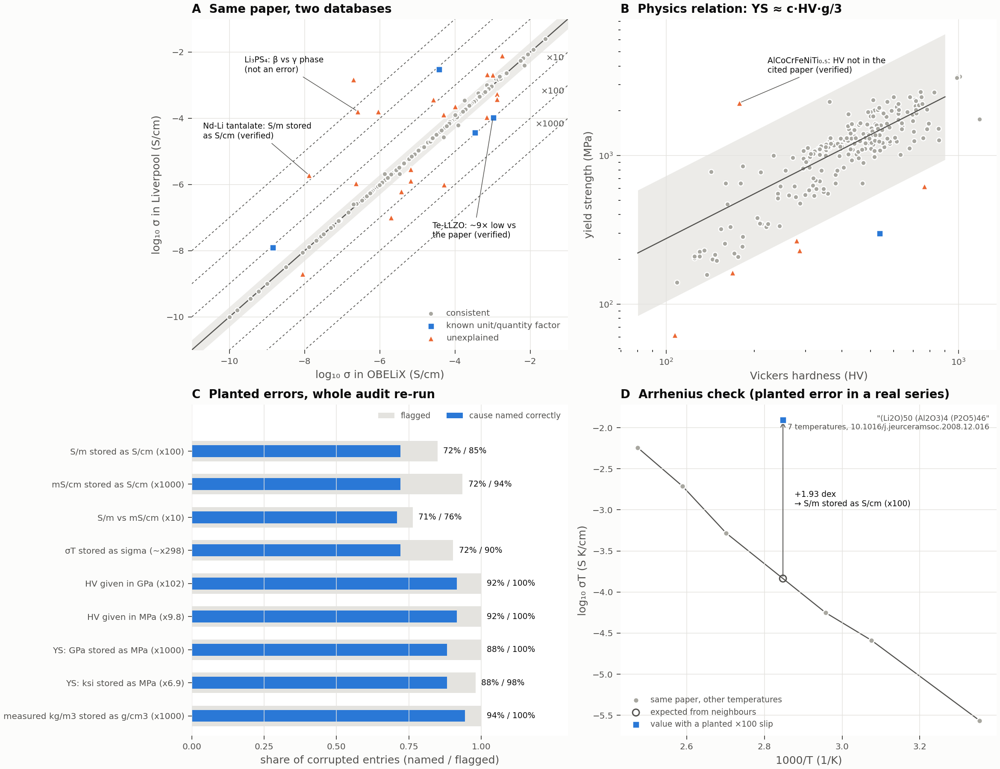

# LitAudit: catching the hidden errors in the databases AI for materials learns from

**Shivasish Mishra** · OSI Hackathon 2026 (Bochum hub) · code: https://github.com/shivasish-mishra/litaudit

**Problem.** Materials ML models are trained on databases built from values copied out of papers. These carry
*structured* errors: unit and quantity mix-ups (S/m stored as S/cm, σT stored as σ, MPa vs GPa, a temperature in
K under a °C label) that shift a value by a fixed factor yet leave it plausible, so outlier filters miss them.
Wang et al. (arXiv 2609.01621, 2026) traced one such 100× error into a public Li-ion conductivity database *by hand*.

**What LitAudit does.** Four automatic checks compare values with independent references; a fifth, agent-driven
step traces flags to their sources.
1. **Two databases**: the same paper + composition in a second database (symmetric: either side may be wrong).
2. **Temperature series**: each point of a paper's Arrhenius series vs its neighbours (a removal test pins the culprit).
3. **Other papers**: the median of other papers reporting the same composition and condition (pins the entry when ≥ 3 papers report it).
4. **Physics**: hardness vs yield strength (Tabor), measured vs calculated density.
5. **Agents** (Claude Code workflow): one agent per flag finds the source through **Valency MCP Bond** and OpenAlex,
   quotes what it reports and judges *database error / physical difference / unclear*; an independent skeptic
   re-fetches the source, checks the quote verbatim and tries to refute the verdict.

The agreement band and factor tolerance come from each check's own scatter σ (band max(0.3, 3σ) dex, tolerance 2σ).
A gap is matched to a library of known factors; a check too noisy to resolve them (papers vs papers for conductivity,
σ ≈ 0.6 dex) flags but never names a cause. Factors in physics relations are signed (a ksi slip can only *lower* a
yield strength). Shown on two unrelated domains: Li-ion conductivity (Liverpool 820 entries, OBELiX 599) and
high-entropy-alloy mechanics (MPEA 1,545 rows).

*A: 203 matched pairs between the two conductivity databases. B: hardness vs yield strength. C: planted errors,
whole audit re-run. D: the Arrhenius check on a real series with a planted ×100 slip.*

**Results.** 1,663 comparisons, 119 flagged. Coverage: 51% of conductivity values have at least one reference (28% from
the database comparison alone); for the alloys 11–47% per property (measured density 100%). Overall only 37% of the
5,357 stored values have any reference, so most are still unchecked. **Planted errors** (stored values corrupted, whole audit re-run): conductivity slips are flagged
**76–94%** of the time, hardness/strength/density slips **98–100%**; the cause is named alone for 71–94%; 0.3–1.1% of
clean entries become false flags.

**Real data, checked against the sources.** 18 flags were traced (7 by hand from the papers and Bond, 11 more only by
the agents). 8 could be settled:
| Verdict | Flags |
|---|---|
| **Database error (5)** | Nd tantalate: Liverpool stored S/m as S/cm (the case Wang et al. found by hand; the tool flagged it, nearest factor ×100) · Te-LLZO ×2: Liverpool 9.5× and 8.7× below the paper's table at the same 30 °C · AlCoCrFeNiTi₀.₅: hardness not in the cited paper · **new, found by the agents**: Li₅PS₄(BH₄)₂, Liverpool 7.96×10⁻³ vs the abstract's "1.8 × 10⁻³ S cm⁻¹ at 25 °C" (= OBELiX) |
| **Physical difference (3)** | Li₃PS₄ ×2: nanoporous β vs bulk phase · LLZO: tetragonal vs cubic (abstract: "about two orders of magnitude lower") |

One more is likely physical (Ta-LLZO: the databases recorded different temperatures, 25 vs 34 °C). The other 9 stay
open: their source is closed (51 of the 75 flagged papers have no open abstract) or its abstract gives no number for
that sample. So **5 of 8 settled flags were real database errors**; the rest was physics that composition alone cannot
separate. **Named causes are unconfirmed on real data**: the Te-LLZO "×10" fits the size of the gap but not the
digits (1.07 vs 1.02), and the agents argue a named "×10" Arrhenius flag is a superionic jump near melting.

**Scalability.** All four checks run in under a second on 5,357 values (the benchmark re-runs them ~30 times).
Adding a database is one loader; adding a property is one entry of known unit factors, optionally a relation or a
series law. What stops scaling is evidence, not compute: overlap between sources, and open text to settle a flag.

**Limitations.** Composition alone cannot separate polymorphs or processing (OBELiX space groups help, Liverpool has
none); attribution is weak when only two values exist; Bond held few of these older sources, so most agent evidence
came from OpenAlex abstracts; most published ground truth sits in closed papers.

**Impact.** Literature databases are infrastructure for AI-driven discovery. LitAudit tells curators and model builders
*which* entries disagree, *whether a fixed-factor slip explains it*, and *what the source says*, and it says
"unexplained" or "unclear" rather than guess.

*Data: Liverpool (Hargreaves et al. 2023, academic licence, not redistributed), OBELiX (CC-BY 4.0), MPEA (Borg et al. 2020,
Apache 2.0). Builds on those datasets; all audit code is new. Source traces: `traces.md`, `traces_agent.json`.*
